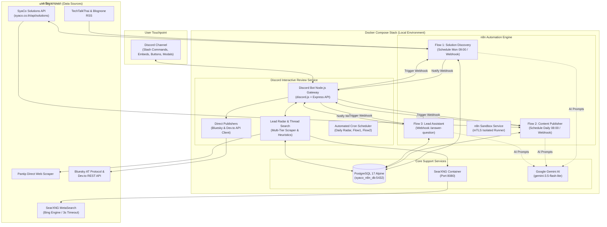
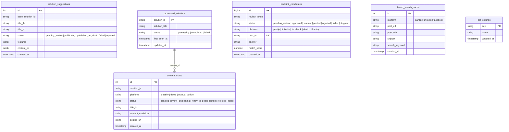
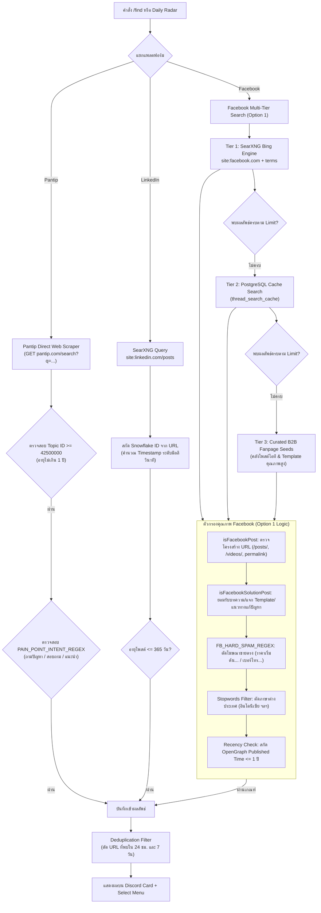
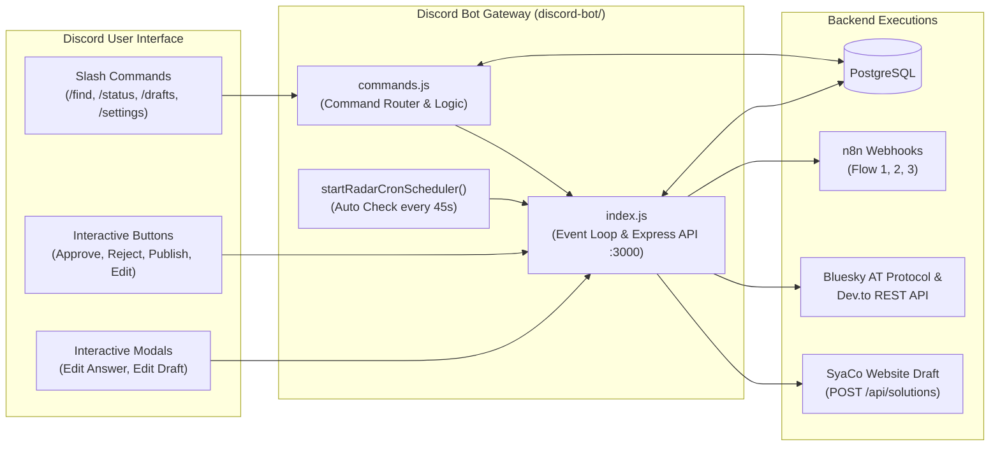

# SyaCo Content & Backlink Automation Stack
## เอกสารสถาปัตยกรรมระบบและโครงสร้างใหม่ (Comprehensive System Architecture)

> **ชื่อระบบ:** SyaCo Content & Backlink Automation Stack (`n8n-sandbox`)  
> **สภาพแวดล้อม:** Docker Compose (Self-Hosted n8n, SearXNG, PostgreSQL 17, Discord Bot, Sandbox Service, Google Gemini AI)  
> **วัตถุประสงค์ของเอกสาร:** แสดงโครงสร้างระบบใหม่ทั้งหมด (Directory Tree, Service Topology, Database Schemas, Multi-Tier Search Engine, Workflows, Discord Slash Commands และ Operational Guide)  
> **เอกสารอ้างอิงหลัก:** ดูรายละเอียดฉบับเต็มได้ที่ [SYSTEM_ARCHITECTURE.md](file:///c:/Users/dYflyTaxi/Desktop/n8n-sandbox/SYSTEM_ARCHITECTURE.md)  
> **เวอร์ชัน:** 2.0 (อัปเดตล่าสุด: พฤศจิกายน 2026)

---

## สารบัญ (Table of Contents)

1. [ภาพรวมระบบและแผนภาพสถาปัตยกรรม (System Overview & Architecture Diagram)](#1-ภาพรวมระบบและแผนภาพสถาปัตยกรรม)
2. [โครงสร้างไดเรกทอรีและหน้าที่ของแต่ละไฟล์ (Directory Structure & File Inventory)](#2-โครงสร้างไดเรกทอรีและหน้าที่ของแต่ละไฟล์)
3. [โครงสร้างคอนเทนเนอร์และระบบเครือข่าย (Docker Compose Stack & Infrastructure)](#3-โครงสร้างคอนเทนเนอร์และระบบเครือข่าย)
4. [โครงสร้างฐานข้อมูล (PostgreSQL Database Architecture & Schemas)](#4-โครงสร้างฐานข้อมูล)
5. [ระบบ Lead Radar และระบบค้นหากระทู้/โพสต์แบบ Multi-Tier (Search Engine Architecture)](#5-ระบบ-lead-radar-และระบบค้นหากระทู้โพสต์แบบ-multi-tier)
6. [สถาปัตยกรรม Discord Interactive Bot & Publisher (`discord-bot/`)](#6-สถาปัตยกรรม-discord-interactive-bot--publisher)
7. [เวิร์กโฟลว์การทำงานอัตโนมัติ (n8n Workflows: Flow 1, 2, 3)](#7-เวิร์กโฟลว์การทำงานอัตโนมัติ)
8. [การทดสอบและการดูแลรักษาระบบ (Testing, Deployment & Maintenance Guide)](#8-การทดสอบและการดูแลรักษาระบบ)

---

## 1. ภาพรวมระบบและแผนภาพสถาปัตยกรรม

ระบบ SyaCo Automation Stack ทำหน้าที่เป็นเครื่องมือการตลาดอัตโนมัติครบวงจรสำหรับธุรกิจ B2B ครอบคลุม:
1. **Flow 1 (Solution Discovery):** วิเคราะห์เทรนด์ไอทีจาก RSS (TechTalkThai, Blognone) เทียบกับโซลูชันปัจจุบันของ SyaCo และสังเคราะห์เป็นไอเดียโซลูชันใหม่พร้อมขึ้น Draft บนเว็บไซต์ SyaCo
2. **Flow 2 (Content Creator & Multi-Platform Publisher):** ตรวจจับโซลูชันใหม่ และสร้างคอนเทนต์สำหรับ 3 แพลตฟอร์ม (Bluesky Micro-post, Dev.to Technical Article, Long-form Manual Article) พร้อมปุ่มกดเผยแพร่อัตโนมัติจาก Discord
3. **Flow 3 & Lead Radar (Community Lead Assistant):** ค้นหากระทู้และโพสต์ Pain Point จาก Pantip, Facebook (Option 1 Fanpage & Guides) และ LinkedIn ประเมินคะแนนความเข้ากันได้ และร่างคำตอบทางวิศวกรรมที่แนบ Backlink เข้าหาโซลูชัน SyaCo อย่างเป็นธรรมชาติ



---

## 2. โครงสร้างไดเรกทอรีและหน้าที่ของแต่ละไฟล์

โครงสร้างโฟลเดอร์ปัจจุบันของโปรเจกต์ `n8n-sandbox`:

```text
n8n-sandbox/
├── .env                              # ไฟล์เก็บ Environment Variables & Credentials [GIT-IGNORED]
├── .env.example                      # แม่แบบ Config ที่ปลอดภัยสำหรับ Commit ขึ้น Git
├── .gitignore                        # กรองไฟล์ชั่วคราว ข้อมูลฐานข้อมูล และ Secrets
├── compose.yml                       # Docker Compose Service Definitions (6 Services)
├── init.sql                          # สคริปต์สร้าง Schema ฐานข้อมูล PostgreSQL ครั้งแรก
├── searxng-settings.yml              # การตั้งค่า Search Engine ของ SearXNG (เปิด Bing / ปิด Google)
├── searxng-limiter.toml              # ปิด Rate Limiter ภายในสำหรับเครือข่าย Docker
├── ARCHITECTURE.md                   # เอกสารอ้างอิงสถาปัตยกรรม (Legacy/Mirror)
├── SYSTEM_ARCHITECTURE.md            # เอกสารสถาปัตยกรรมฉบับสมบูรณ์
│
├── discord-bot/                      # บริการ Discord Bot (Node.js 20 ESM/CJS)
│   ├── Dockerfile                    # Image build specification
│   ├── package.json                  # Dependencies (discord.js, express, pg, atproto)
│   ├── index.js                      # Main Gateway, Express API (/notify), Interaction Handler, Cron
│   ├── commands.js                   # นิยามและโค้ดประมวลผล Slash Commands ทั้งหมด 11 คำสั่ง
│   ├── thread-search.js              # ระบบ Lead Radar ค้นหากระทู้ 3 แพลตฟอร์ม (Option 1 FB Logic)
│   ├── flow2-publisher.js            # ตัวยิงโพสต์เข้า Bluesky (AT Protocol) และ Dev.to REST API
│   ├── solution-draft.js             # โมดูลสร้าง Solution Draft บนเว็บไซต์ SyaCo (Flow 1 Approve)
│   ├── test-commands.js              # Unit Test ครอบคลุม Slash Commands ทุกคำสั่ง
│   ├── test_unit_filters.js          # Unit Test ตัวกรอง Thread Search, FB Option 1 และ Heuristics
│   ├── test-draft.js                 # Unit Test สำหรับ SyaCo Draft Creator
│   └── test-flow2-publisher.js       # Unit Test สำหรับ Social Publishing
│
├── workflows/                        # ไฟล์ JSON ของ n8n Workflows
│   ├── flow1-solution-discovery.json         # Flow 1: ค้นหาไอเดียโซลูชันใหม่จากเทรนด์ไอที
│   ├── flow2-content-publisher.json          # Flow 2: สร้างและเตรียมร่างคอนเทนต์ 3 แพลตฟอร์ม
│   ├── flow3-community-lead-assistant.json   # Flow 3: ระบบคัดกรอง Lead และร่างคำตอบสำหรับ Community
│   ├── README.md                             # คำอธิบายรายละเอียดและการทำงานของ Workflows
│   └── archive/                              # ไฟล์ Workflows เวอร์ชันก่อนหน้า
│
├── scripts/                          # สคริปต์ยูทิลิตี้สำหรับทดสอบและบำรุงรักษาระบบ
│   ├── check-node-references.js      # ตรวจสอบการอ้างอิงโหนดข้ามขั้นตอนใน n8n Workflow JSON
│   ├── inspect-execution.py          # สคริปต์สืบค้นประวัติการรันและ Payload ใน SQLite ของ n8n
│   ├── seed-solutions.js             # ดึงโซลูชันจากเว็บ SyaCo มา Seed ใส่ตาราง processed_solutions
│   ├── sync-workflows.py             # ซิงก์ไฟล์ workflow JSON ไปยังฐานข้อมูล SQLite ภายในของ n8n
│   ├── test-db-schema.js             # ตรวจสอบความถูกต้องของ Schema และ Constraints ใน PostgreSQL
│   ├── test-flow1-feeds.js           # ทดสอบดึงและ Parse RSS Feed ของ TechTalkThai และ Blognone
│   ├── test-flow1.js                 # ทดสอบฟังก์ชัน Prompt Assembler ของ Flow 1
│   ├── test-flow2.js                 # ทดสอบ Tag Sanitizer และคำนวณ Byte Offset สำหรับ Bluesky
│   ├── test-flow3.js                 # ทดสอบ URL Normalizer และ Anti-Spam Quota
│   └── verify-all.js                 # รันชุดทดสอบ Integration ทั้งหมด
│
├── skills/                           # ข้อกำหนด Persona และกฎ Anti-Spam สำหรับ AI
│   ├── shared_persona_rules.js       # โมดูล Persona และคำแนะนำ Prompt ภาษาไทยสำหรับ Gemini
│   ├── shared_persona_rules.md       # เอกสารสรุปข้อกำหนด Persona
│   ├── anti_spam.md                  # แนวปฏิบัติการตอบกระทู้เพื่อสร้าง Backlink แบบ Organic
│   └── humanizer.md                  # เทคนิคการเกลาภาษาไม่ให้ดูเหมือนข้อความที่สร้างโดย AI
│
├── pgdata/                           # Volume ข้อมูลจริงของ PostgreSQL [GIT-IGNORED]
└── n8n_data/                         # Volume ข้อมูลจริงของ n8n (SQLite DB, Execution Logs) [GIT-IGNORED]
```

---

## 3. โครงสร้างคอนเทนเนอร์และระบบเครือข่าย

ระบบถูกจัดระเบียบบน [compose.yml](file:///c:/Users/dYflyTaxi/Desktop/n8n-sandbox/compose.yml) โดยแบ่งเป็น 6 บริการหลัก:

| ชื่อคอนเทนเนอร์ (Service) | Docker Image | พอร์ต Host:Container | หน้าที่และความสัมพันธ์ (Role & Description) |
|---|---|---|---|
| **`postgres`** | `postgres:17-alpine` | `127.0.0.1:5680:5432` | ฐานข้อมูลหลัก `syaco_n8n_db` เก็บข้อมูลแคนดิเดต, ดราฟต์, แคชกระทู้ และสถานะการทำงาน |
| **`searxng`** | `searxng/searxng:latest` | `127.0.0.1:5679:8080` | เมตาเสิร์ชเอนจินภายใน ใช้ค้นหาข้อมูลจาก Bing โดยไม่มีการจำกัดอัตรา |
| **`n8n`** | `docker.n8n.io/n8nio/n8n:latest` | `127.0.0.1:5678:5678` | ระบบ Orchestration หลัก ทำงานอัตโนมัติตามตารางเวลาและรับ Webhook |
| **`discord-bot`** | Custom build (`./discord-bot`) | Internal: `3000` | ตัวกลางประสานระหว่างมนุษย์กับระบบ (UI, Approval, Slash Commands, Scheduler, Direct Publisher) |
| **`sandbox-api`** | `n8nio/n8n-sandbox-service-api:1.4.0` | `127.0.0.1:5681:8080` | ควบคุมการรันโค้ดแบบแยกส่วน (Isolated Code Execution) สำหรับ n8n AI Nodes |
| **`sandbox-runner-1`** | `n8nio/n8n-sandbox-service-runner-dind:1.4.0` | Internal gRPC (`9091`) | รันเนอร์สิทธิพิเศษสำหรับรันโค้ด Sandbox |
| **`sandbox-certs`** | `n8nio/n8n-sandbox-service-api:1.4.0` | N/A (One-shot) | สร้างใบรับรอง mTLS สำหรับการสื่อสารระหว่าง Sandbox API และ Runner |

### การเชื่อมต่อเครือข่าย (Container Networking)
* คอนเทนเนอร์ทุกตัวทำงานอยู่บนเครือข่ายบริดจ์ดีฟอลต์ของ Docker Compose ทำให้สามารถเรียกหากันด้วยชื่อบริการได้ เช่น:
  * Discord Bot ติดต่อ PostgreSQL ผ่าน `postgres:5432`
  * Discord Bot ติดต่อ SearXNG ผ่าน `http://searxng:8080`
  * Discord Bot ยิง Webhook ไปหา n8n ผ่าน `http://n8n:5678/webhook/...`
  * n8n ส่งการแจ้งเตือนกลับมาหา Discord Bot ผ่าน `http://discord-bot:3000/notify`

---

## 4. โครงสร้างฐานข้อมูล

ฐานข้อมูล PostgreSQL `syaco_n8n_db` ประกอบด้วย 6 ตารางที่มีสถานะการทำงานแบบ Atomic State Machine ป้องกัน Race Condition และการประมวลผลซ้ำ:



### รายละเอียดตารางและหน้าที่:

1. **`solution_suggestions` (Flow 1: Adjacent Solutions):**
   - จัดเก็บไอเดียโซลูชันใหม่ที่สังเคราะห์โดย Gemini AI
   - สถานะ: `pending_review` ➔ `publishing` (Atomic Lock) ➔ `published_as_draft` (สร้างบนเว็บแล้ว) หรือ `rejected` / `failed`

2. **`processed_solutions` (Flow 2: Idempotency Lock):**
   - บันทึก `solution_id` ของโซลูชันจากเว็บ SyaCo ที่นำมาประมวลผลแล้ว เพื่อป้องกันไม่ให้ Flow 2 นำโซลูชันเดิมมาทำซ้ำ
   - สถานะ: `processing` ➔ `completed` หรือ `failed`

3. **`content_drafts` (Flow 2: Multi-Platform Drafts):**
   - จัดเก็บร่างคอนเทนต์ที่สร้างเสร็จสำหรับ 3 แพลตฟอร์ม (`bluesky`, `devto`, `manual_article`)
   - มี Unique Constraint `(solution_id, platform)` ป้องกันคอนเทนต์ซ้ำ
   - เมื่อกด Publish บน Discord ระบบจะล็อกสถานะเป็น `publishing` ทันทีผ่าน SQL:
     ```sql
     UPDATE content_drafts SET status = 'publishing'
     WHERE id = $1 AND status = 'pending_review'
     RETURNING *;
     ```

4. **`backlink_candidates` (Flow 3: Community Lead Q&A):**
   - จัดเก็บกระทู้และโพสต์ที่ผ่านการประเมินคะแนนความเหมาะสม (Lead Fit Score) และร่างคำตอบเชิงวิศวกรรม
   - มี Unique Index บน `post_url` เพื่อป้องกันการบันทึกกระทู้ซ้ำ

5. **`thread_search_cache` (Lead Radar Cache & Quality Pool):**
   - แคชผลการค้นหาจาก Lead Radar เพื่อเชื่อมโยงกับ Select Menu ใน Discord
   - ใช้ตรวจสอบ URL ที่เพิ่งพบใน 24 ชั่วโมง หรือ 7 วันที่ผ่านมา เพื่อไม่ให้ส่งกระทู้ซ้ำ
   - ทำหน้าที่เป็นคลังโพสต์คุณภาพสูงสำหรับ Fallback Tier 2 ในการค้นหา Facebook

6. **`bot_settings` (Runtime Dynamic Configurations):**
   - เก็บการตั้งค่าแบบ Key-Value ที่ปรับแต่งได้สดผ่านคำสั่ง `/settings`:
     - `default_channel_id`: ช่อง Discord สำหรับส่งการแจ้งเตือน
     - `admin_user_ids`: รายชื่อ User ID ที่มีสิทธิ์อนุมัติและสั่งการ
     - `daily_radar_time` / `daily_radar_enabled`: เวลาและสถานะเปิด/ปิด Radar อัตโนมัติ (เช่น `08:30`)
     - `flow1_time` / `flow1_enabled`: เวลาเปิด/ปิด Flow 1 อัตโนมัติ (เช่น `10:30`)
     - `flow2_time` / `flow2_enabled`: เวลาเปิด/ปิด Flow 2 อัตโนมัติ (เช่น `11:30`)
     - `devto_api_key` / `devto_cookie`: Credentials สำหรับ Dev.to

---

## 5. ระบบ Lead Radar และระบบค้นหากระทู้/โพสต์แบบ Multi-Tier

ระบบค้นหากระทู้ของโปรเจกต์ได้รับการออกแบบใน [`discord-bot/thread-search.js`](file:///c:/Users/dYflyTaxi/Desktop/n8n-sandbox/discord-bot/thread-search.js) เพื่อค้นหาโพสต์ที่เป็นโอกาสทางธุรกิจ (B2B Leads & Pain Points) ในช่วงเวลาย้อนหลัง 1 ปี

### แผนภาพการสืบค้นแบบ Multi-Tier:



### สรุปหลักการสำคัญของแต่ละแพลตฟอร์ม:

1. **Pantip (Native Direct Scraper):**
   - ยิงค้นหาตรงไปยัง `https://pantip.com/search?q=...` โดยไม่ผ่าน Search Engine ภายนอก ทำให้ได้กระทู้ล่าสุดและแม่นยำสูง
   - **Recency Filter:** ตรวจสอบรหัสกระทู้ (Topic ID) ด้วยเกณฑ์ Dynamic Threshold (`42500000` เทียบเท่าประมาณ 1 ปี)
   - **Intent Filter:** ต้องผ่าน `PAIN_POINT_INTENT_REGEX` (เช่น มีคำว่า *ช่วยด้วย, แนะนำ, ปัญหา, ปรึกษา, ใครเคยใช้, erp, wms, ระบบ*) และไม่เป็นกระทู้ลบด้วย `NEGATIVE_INTENT_REGEX` (เช่น ประกาศหางาน, รับสมัครงาน)

2. **Facebook (Option 1 Architecture):**
   - **เหตุผลของการใช้ Option 1:** โพสต์บน Facebook กลุ่มปิดมักถูก Search Engine ปิดกั้นการมองเห็น แต่โพสต์จากเพจสาธารณะที่แบ่งปันวิธีแก้ปัญหา, แจก Template ระบบ หรือวิเคราะห์แนวทางจัดการสต็อก/ERP มีคุณค่าสูงในการเข้าไปคอมเมนต์ต่อยอด
   - **Relevance Ranking แบบ 2-Pass:**
     - *Pass 1 (Strict Relevance):* ค้นหาโพสต์ที่มี Keyword ที่ระบุตรงตัว (เช่น ค้นหา `WMS` ต้องมีคำว่า `wms` หรือ `คลังสินค้า` อยู่ในเนื้อหา)
     - *Pass 2 (Contextual Relevance):* ค้นหาโพสต์แนวทางการบริหารจัดการไอทีและระบบธุรกิจทั่วไป
   - **ตัวกรอง Anti-Spam:** ตัดข้อความโฆษณาฮาร์ดเซลล์ (`FB_HARD_SPAM_REGEX`) และตัดข้อความที่เป็น Placeholder เช่น `"โพสต์ข้อความบน Facebook เกี่ยวกับ"`
   - **การสกัดเวลา:** ใช้วิธี Unfurl Open Graph Metadata จากตัวโพสต์เพื่อตรวจสอบ `article:published_time`

3. **LinkedIn (Snowflake Timestamp Decoder):**
   - ดึง URL จาก SearXNG
   - สกัดรหัส Activity ID / Post ID จาก URL แล้วนำมาแปลงด้วยบิตชิฟต์แบบ Snowflake (`id >> 22`) ทำให้ทราบวันเวลาที่โพสต์จริงได้อย่างแม่นยำ 100% โดยไม่ต้องพึ่งพาข้อมูลบนหน้าเว็บ

---

## 6. สถาปัตยกรรม Discord Interactive Bot & Publisher

บอท Discord ถูกเขียนด้วย Node.js 20 ทำหน้าที่เป็นทั้ง **Interactive Command Hub**, **Workflow Scheduler** และ **Direct API Publisher**:



### สรุปคำสั่ง Slash Commands (11 คำสั่ง):

| คำสั่ง (Command) | พารามิเตอร์ | สิทธิ์ | หน้าที่และการทำงาน (Functionality) |
|---|---|---|---|
| **`/find`** | `[keyword] [platform] [limit]` | ทุกคน | ค้นหากระทู้/โพสต์ที่น่าสนใจในช่วง 1 ปี แสดงผลเป็น Embed พร้อม Select Menu สำหรับกดให้ AI ร่างคำตอบทันที |
| **`/answer`** | `[platform] [url] [problem]` | ทุกคน | ส่ง URL กระทู้เข้า Flow 3 เพื่อวิเคราะห์ Lead Fit และร่างคำตอบ |
| **`/settings`** | `view`, `radar`, `flow1`, `flow2`, `channel`, `admin`, `devto` | แอดมิน | ตั้งค่าเวลา Cron อัตโนมัติ, ช่องแจ้งเตือน, รายชื่อแอดมิน และ API Key แบบไม่ต้องรีสตาร์ทบอท |
| **`/status`** | `[view: summary/flow1/flow2/flow3/all]` | ทุกคน | แสดงสถานะ Pipeline, คิวรออนุมัติ, สถิติโพสต์สำเร็จ และประวัติ Error ล่าสุด |
| **`/drafts`** | `[limit] [view: pending/all]` | ทุกคน | ดูรายการร่างคอนเทนต์ที่รอเผยแพร่ พร้อมปุ่มกดสั่ง Publish เข้าโซเชียลมีเดีย |
| **`/idea`** | `[solution]` | แอดมิน | สั่งรัน Flow 1 ทันทีเพื่อสังเคราะห์ไอเดียโซลูชันใหม่จากเทรนด์ล่าสุด |
| **`/publish`** | - | แอดมิน | ตรวจสอบและแสดงรายการดราฟต์ที่พร้อมเผยแพร่ พร้อมปุ่มสั่งยิงขึ้นแพลตฟอร์มทันที |
| **`/health`** | - | ทุกคน | ตรวจสอบสถานะการเชื่อมต่อของ PostgreSQL, SearXNG, n8n และ Discord Gateway |
| **`/help`** | - | ทุกคน | แสดงคู่มือการใช้งานระบบและคำแนะนำการใช้คำสั่งทั้งหมด |
| **`/set-channel`** | `[channel]` | แอดมิน | (Legacy Alias) กำหนดช่องหลักสำหรับรับการแจ้งเตือน |
| **`/set-admin-ids`**| `[ids]` | แอดมิน | (Legacy Alias) กำหนดสิทธิ์ User ID ของแอดมิน |

### ระบบเผยแพร่ตรง (Direct Publishers ใน `flow2-publisher.js`):
1. **Bluesky (`publishBlueskyPost`):**
   - ใช้งานผ่าน `@atproto/api` โดยล็อกอินด้วย `BLUESKY_HANDLE` และ `BLUESKY_APP_PASSWORD`
   - ตรวจจับและสร้าง Facet สำหรับ Link (`app.bsky.richtext.facet`) และ Tag อัตโนมัติ
   - ตรวจสอบความยาวไม่เกิน 300 ตัวอักษรตามมาตรฐาน Bluesky
2. **Dev.to (`publishDevtoArticle`):**
   - ยิงตรงเข้า `https://dev.to/api/articles` โดยใช้ `DEVTO_API_KEY`
   - แปลงหัวข้อและเนื้อหา Markdown พร้อมระบุ `canonical_url` และ Sanitize Tags ไม่เกิน 4 แท็ก

---

## 7. เวิร์กโฟลว์การทำงานอัตโนมัติ

ไฟล์เวิร์กโฟลว์ทั้งหมดเก็บอยู่ในโฟลเดอร์ [`workflows/`](file:///c:/Users/dYflyTaxi/Desktop/n8n-sandbox/workflows/):

### Flow 1: Adjacent Solution Discovery ([`flow1-solution-discovery.json`](file:///c:/Users/dYflyTaxi/Desktop/n8n-sandbox/workflows/flow1-solution-discovery.json))
* **Triggers:**
  * Schedule Trigger: ทุกวันจันทร์ เวลา 09:00 น.
  * Webhook Trigger: `POST /webhook/flow1-request-idea`
* **Flow Logic:**
  1. ดึงโซลูชันปัจจุบันจาก `https://www.syaco.co.th/api/solutions`
  2. อ่าน RSS Feed ล่าสุดจาก TechTalkThai และ Blognone
  3. ส่งข้อมูลให้ Gemini AI สังเคราะห์ Adjacent Solution ระดับ B2B ที่เชื่อมโยงกับความเชี่ยวชาญของ SyaCo
  4. บันทึกลงตาราง `solution_suggestions` ในสถานะ `pending_review`
  5. ยิง Webhook แจ้งเตือนเข้า Discord Bot (`/notify`) เพื่อแสดง Embed Card พร้อมปุ่ม **Approve** และ **Reject**
  6. เมื่อแอดมินกด Approve บอทจะล็อกสถานะเป็น `publishing` และเรียกโมดูล `solution-draft.js` เพื่อสร้าง Draft โซลูชันบนเว็บไซต์ SyaCo ทันที

### Flow 2: Content Creator & Multi-Platform Publisher ([`flow2-content-publisher.json`](file:///c:/Users/dYflyTaxi/Desktop/n8n-sandbox/workflows/flow2-content-publisher.json))
* **Triggers:**
  * Schedule Trigger: ทุกวัน เวลา 08:00 น.
  * Webhook Trigger: `POST /webhook/flow2-run-publisher`
* **Flow Logic:**
  1. ดึงโซลูชันทั้งหมดจาก SyaCo API และเปรียบเทียบกับตาราง `processed_solutions`
  2. กรองเฉพาะโซลูชันใหม่ที่ยังไม่เคยถูกประมวลผล (หากไม่มีโซลูชันใหม่ ระบบจะจบการทำงานเงียบๆ ไม่ส่งแจ้งเตือนรบกวน)
  3. ล็อกสถานะโซลูชันเป็น `processing`
  4. ส่ง Prompt ให้ Gemini AI ทำงานแบบขนาน (Parallel Calls):
     * **Call A:** สร้าง Micro Post สำหรับ Bluesky และ Technical Article สำหรับ Dev.to
     * **Call B:** สร้าง Enterprise Long-form Article สำหรับเผยแพร่แบบแมนนวล
  5. ทำความสะอาดแท็กและบันทึกลงตาราง `content_drafts`
  6. ส่ง Embed Card เข้า Discord พร้อมปุ่ม Publish ตรงเข้าสู่แต่ละแพลตฟอร์ม

### Flow 3: Community Lead Assistant ([`flow3-community-lead-assistant.json`](file:///c:/Users/dYflyTaxi/Desktop/n8n-sandbox/workflows/flow3-community-lead-assistant.json))
* **Triggers:**
  * Webhook Trigger: `POST /webhook/answer-question` (เรียกผ่านคำสั่ง `/answer` หรือ Select Menu ของ `/find`)
* **Flow Logic:**
  1. Normalize URL และตัดพารามิเตอร์ที่ไม่จำเป็น
  2. ตรวจสอบโควตา Anti-Spam (จำกัดไม่เกิน 5 โพสต์ต่อสัปดาห์) และป้องกันกระทู้ซ้ำ
  3. ตอบรับ Webhook ทันที (`202 Accepted`) เพื่อไม่ให้ Discord Interaction หมดเวลา (Timeout 3 วินาที)
  4. ดึงข้อมูลโซลูชันของ SyaCo และให้ Gemini AI ประเมินคะแนนความเหมาะสม (Lead Fit Score 1–10)
  5. หากคะแนนผ่านเกณฑ์ จะร่างคำตอบเชิงเทคนิคที่ช่วยแก้ปัญหาของผู้ถามอย่างแท้จริง พร้อมสอดแทรก Backlink อย่างเป็นธรรมชาติ (ตามหลักเกณฑ์ใน `skills/anti_spam.md` และ `skills/shared_persona_rules.js`)
  6. บันทึกลงตาราง `backlink_candidates` และส่งการ์ดตรวจสอบเข้า Discord พร้อมปุ่ม **Approve**, **Edit** และ **Reject**

---

## 8. การทดสอบและการดูแลรักษาระบบ

### คำสั่ง Docker Compose ที่สำคัญ:

```powershell
# 1. เริ่มการทำงานของทุกคอนเทนเนอร์ในโหมด Background
docker compose up -d

# 2. ดูสถานะการทำงานของคอนเทนเนอร์ทั้งหมด
docker compose ps

# 3. บิลด์ Discord Bot ใหม่หลังแก้ไขโค้ด (เนื่องจากไม่ได้ต่อ Volume โค้ดไว้)
docker compose build discord-bot
docker compose restart discord-bot

# 4. ดู Log การทำงานแบบ Real-time ของ Discord Bot หรือ n8n
docker compose logs -f discord-bot
docker compose logs -f n8n
docker compose logs -f searxng
```

### การรันชุดทดสอบความถูกต้อง (Test Suites):

```powershell
# 1. ทดสอบตัวกรองกระทู้, กฎ Option 1 ของ Facebook และ Heuristics ทั้งหมด (11 Test Suites)
node discord-bot/test_unit_filters.js

# 2. ทดสอบคำสั่ง Slash Commands ทั้งหมดของ Discord Bot (14 Unit Tests)
node discord-bot/test-commands.js

# 3. ตรวจสอบการเชื่อมต่อ Schema และ Constraints ใน PostgreSQL
node scripts/test-db-schema.js

# 4. ตรวจสอบการอ้างอิงโหนดใน n8n Workflow JSON
node scripts/check-node-references.js

# 5. ซิงก์ Workflow JSON เข้าสู่ฐานข้อมูล n8n SQLite ภายใน
python scripts/sync-workflows.py
```

### รายการตัวแปรสภาพแวดล้อมที่สำคัญ (`.env`):

| ตัวแปร (Key) | ตัวอย่างค่า | คำอธิบาย |
|---|---|---|
| `POSTGRES_DB` | `syaco_n8n_db` | ชื่อฐานข้อมูล PostgreSQL |
| `POSTGRES_USER` | `postgres` | บัญชีผู้ใช้ฐานข้อมูล |
| `POSTGRES_PASSWORD` | `admin` | รหัสผ่านฐานข้อมูล |
| `GEMINI_API_KEY` | `AIzaSy...` | API Key สำหรับเรียกโมเดล Google Gemini |
| `GEMINI_MODEL` | `gemini-3.5-flash-lite` | โมเดลภาษาที่ใช้งานสำหรับสังเคราะห์คอนเทนต์ |
| `DISCORD_BOT_TOKEN` | `MTI...` | Token ของ Discord Bot |
| `DISCORD_CHANNEL_ID` | `130...` | ID ของช่อง Discord สำหรับรับการแจ้งเตือน |
| `DISCORD_ADMIN_IDS` | `123456789,987654321` | รายชื่อ Discord User ID ของผู้มีสิทธิ์อนุมัติ |
| `BLUESKY_HANDLE` | `syaco.bsky.social` | Handle บัญชี Bluesky สำหรับเผยแพร่โพสต์ |
| `BLUESKY_APP_PASSWORD` | `xxxx-xxxx-xxxx-xxxx` | App Password ของ Bluesky |
| `DEVTO_API_KEY` | `devto_api_...` | API Key สำหรับเผยแพร่บทความบน Dev.to |
| `SYACO_API_URL` | `https://www.syaco.co.th/api/solutions` | API ดึงรายการโซลูชันของบริษัท |
| `SYACO_API_TOKEN` | `secret_token` | Token สำหรับยืนยันตัวตนในการสร้าง Solution Draft |
| `SEARXNG_URL` | `http://searxng:8080` | URL สำหรับเรียกใช้งาน SearXNG ภายในเครือข่าย Docker |
