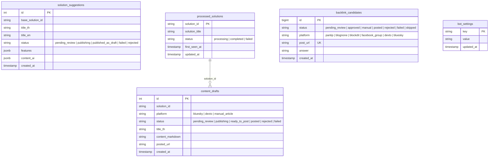

# System Architecture & Technical Specifications

> **System Name:** SyaCo Content & Backlink Automation Stack (`n8n-sandbox`)  
> **Target Environment:** Docker Compose (Self-Hosted n8n + SearXNG + PostgreSQL 17 + Discord Bot + Sandbox Service + Gemini AI)  
> **Document Purpose:** System Overview, File Hierarchy, Container Specifications, and Production Workflow Reference.

---

## 1. Directory Structure & File Inventory

```text
n8n-sandbox/
├── .env                              # Local environment variables & secrets [GIT-IGNORED]
├── .env.example                      # Git-safe environment template
├── .gitignore                        # Secret protection & runtime data exclusions
├── compose.yml                       # Docker Compose services definition (n8n, postgres, discord-bot, searxng, sandbox)
├── init.sql                          # Complete PostgreSQL schema (all 4 tables + bot_settings)
├── searxng-settings.yml              # SearXNG Engine configuration
├── ARCHITECTURE.md                   # System Architecture & Technical Reference (This File)
├── implementation_plan.md            # Detailed implementation plan & design specifications
│
├── workflows/                        # Production & version-controlled n8n workflow JSONs
│   ├── flow1-solution-discovery.json         # Flow 1: Adjacent Solution Discovery
│   ├── flow2-content-publisher.json          # Flow 2: Content Creator & Multi-Platform Publisher
│   ├── flow3-community-lead-assistant.json   # Flow 3: Community Lead Assistant (/answer on-demand)
│   ├── README.md                             # Workflows catalog and node wiring guide
│   └── archive/                              # Archived legacy workflows
│
├── discord-bot/                      # Node.js Discord Interactive Review Bot & Publisher
│   ├── Dockerfile                    # Bot container specification
│   ├── package.json                  # Dependencies (discord.js, express, pg)
│   ├── index.js                      # Gateway client, modal handlers & /notify internal API
│   ├── commands.js                   # Slash commands (/answer, /set-channel, /settings, etc.)
│   ├── flow2-publisher.js            # Direct publishers (Bluesky AT Protocol, Dev.to REST API)
│   ├── solution-draft.js             # Flow 1 SyaCo web draft creator & atomic locking
│   ├── test-draft.js                 # Unit tests for solution draft creator
│   └── test-flow2-publisher.js       # Unit tests for Flow 2 direct publishers
│
├── scripts/                          # Automated testing, sync, and verification utilities
│   ├── check-node-references.js      # Verifies cross-node expression references across all workflows
│   ├── inspect-execution.py          # Inspects n8n execution history and payloads in SQLite
│   ├── seed-solutions.js             # Seeds existing SyaCo solutions into processed_solutions table
│   ├── sync-workflows.py             # Syncs workflow JSON files to n8n SQLite runtime database
│   ├── test-db-schema.js             # Validates PostgreSQL table schemas and constraints
│   ├── test-flow1-feeds.js           # Verifies TechTalkThai and Blognone RSS feed parsers
│   ├── test-flow1.js                 # Unit tests for Flow 1 Adjacent Solution prompt assembler
│   ├── test-flow2.js                 # Unit tests for Flow 2 tag sanitizer and UTF-8 byte offset
│   ├── test-flow3.js                 # Unit tests for Flow 3 URL normalizer and platform router
│   └── verify-all.js                 # End-to-end integration verification runner
│
├── skills/                           # Prompt engineering & AI agent persona definitions
│   ├── anti_spam.md                  # Anti-Spam & Stealth Community Persona Skill
│   └── humanizer.md                  # Natural language humanizer guidelines
│
└── n8n_data/                         # n8n local runtime data & SQLite database [GIT-IGNORED]
    └── database.sqlite               # n8n internal database (workflows, credentials, execution history)
```

---

## 2. Docker Compose Stack (`compose.yml`)

| Service Name | Docker Image | Port Mapping (Host:Container) | Role & Specifications |
|---|---|---|---|
| **`n8n`** | `docker.n8n.io/n8nio/n8n:latest` | `127.0.0.1:5678:5678` | Automation engine running Flow 1, 2, and 3. Connected to PostgreSQL and internal sandbox service. |
| **`postgres`** | `postgres:17-alpine` | `127.0.0.1:5680:5432` | Primary transactional database `syaco_n8n_db`. Initialized via `./init.sql`. |
| **`discord-bot`** | Custom build (`./discord-bot`) | Internal: `3000` | Discord Interactive Bot for human review, approvals, and direct publishing to Bluesky & Dev.to. |
| **`searxng`** | `searxng/searxng:latest` | `127.0.0.1:5679:8080` | Privacy-respecting metasearch engine for scraping and research without API fees. |
| **`sandbox-api`** | `n8nio/n8n-sandbox-service-api:1.4.0` | `127.0.0.1:8080:8080` | Isolated code execution sandbox for n8n AI nodes. |
| **`sandbox-runner-1`** | `n8nio/n8n-sandbox-service-runner-dind:1.4.0` | Internal gRPC | Privileged execution runner. |
| **`sandbox-certs`** | `n8nio/n8n-sandbox-service-api:1.4.0` | N/A | One-shot mTLS certificate generator for gRPC. |

---

## 3. Database Architecture (PostgreSQL `syaco_n8n_db`)

The database consists of 5 dedicated tables managed with strict atomic state machines and idempotency constraints:



---

## 4. Workflows Overview

### Flow 1: Solution Discovery (`workflows/flow1-solution-discovery.json`)
- **Trigger:** Schedule (every Monday 09:00 AM) or Webhook `POST /webhook/flow1-request-idea`.
- **Logic:**
  1. Fetches current solutions from `https://www.syaco.co.th/api/solutions`.
  2. Fetches RSS feeds from TechTalkThai and Blognone (`https://www.blognone.com/node/feed`).
  3. Uses Gemini AI to design adjacent B2B solutions with structured Bilingual (TH/EN) schemas.
  4. Saves to `solution_suggestions` (`status = 'pending_review'`).
  5. Sends interactive Discord Card with **Approve** and **Reject** buttons.
  6. On Approve: Bot locks suggestion atomically (`status = 'publishing'`) and creates Draft on SyaCo website via `POST /api/solutions`.

### Flow 2: Content Creator & Multi-Platform Publisher (`workflows/flow2-content-publisher.json`)
- **Trigger:** Schedule (every 24h at 08:00 AM) or Webhook `POST /webhook/flow2-run-publisher`.
- **Logic:**
  1. Detects new solutions from `https://www.syaco.co.th/api/solutions` not in `processed_solutions`.
  2. Splits in batches (batch size: 1) and locks solution as `processing`.
  3. Invokes Gemini AI in two parallel calls:
     - **Call A:** Micro Post (Bluesky) + Dev.to Technical Article.
     - **Call B:** Enterprise Long-form Article (Manual Posting).
  4. Sanitizes tags and inserts drafts atomically into `content_drafts` via CTE query.
  5. Sends review embed to Discord with separate action buttons.
  6. Publishing is handled directly by Discord Bot (`flow2-publisher.js`) with atomic state lock.

### Flow 3: Community Lead Assistant (`workflows/flow3-community-lead-assistant.json`)
- **Trigger:** Discord Slash Command `/answer` via Webhook `POST /webhook/answer-question`.
- **Logic:**
  1. Enforces anti-spam quota: maximum 3–5 candidate answers per rolling 7 days.
  2. Normalizes target URL (Pantip topic ID, Facebook story ID, etc.) for deduplication.
  3. Evaluates B2B Enterprise lead fit and computes match score.
  4. Generates natural, anti-spam technical reply using persona guidelines.
  5. Records into `backlink_candidates`.
  6. Posts review card to Discord. Approved responses are auto-posted (Bluesky, Dev.to) or marked for manual posting (Pantip, Blognone, Facebook).

---

## 5. Clean Code & Operational Rules

1. **No Embedded Secrets:** Pass credentials via environment variables (`.env`).
2. **Atomic Locks for Idempotency:** Any publishing operation MUST use PostgreSQL atomic updates (`UPDATE ... WHERE status = 'pending_review' RETURNING *;`) before initiating external network requests to prevent duplicate submissions.
3. **Workflow Sync:** When modifying workflow JSON files, always run `python scripts/sync-workflows.py` to sync updates into n8n SQLite database.
4. **Automated Verification:** Run `npm test` in `discord-bot/` and `node scripts/check-node-references.js` before deploying changes.
